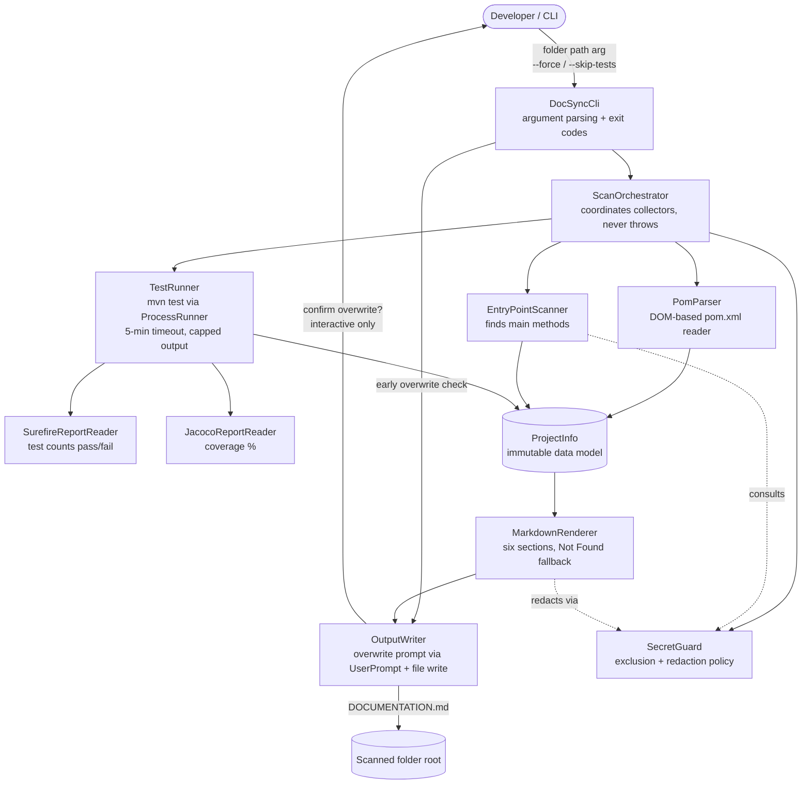
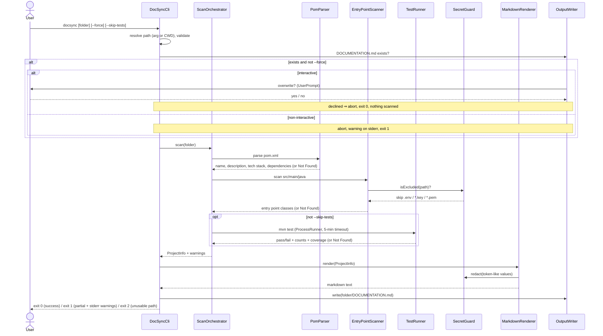

# Architecture — US-101: Automated Documentation Sync

> **Input artifact:** [requirements.md](./requirements.md) (Stage 1, Approved, commit `3a3e62d`)
> **Design decisions by user:** pom.xml parsing = built-in Java DOM parser; test execution = `ProcessBuilder` + report parsing.
> **Revised in Stage 3:** see [design-review.md](./design-review.md) for the findings (DR-1…DR-10) that drove the changes marked below.

## 1. Context and Goals

A one-shot Java 17 CLI tool (`docsync`) that scans a Maven project folder and generates a
`DOCUMENTATION.md` at its root. The architecture must satisfy these goals:

| Goal | Description | Requirement IDs |
|---|---|---|
| G-1 | Accept an optional folder argument, defaulting to the current working directory | FR-1 |
| G-2 | Produce `DOCUMENTATION.md` with exactly six sections (name, description, tech stack, dependencies, entry points, test status) | FR-2, FR-4, FR-5, FR-6, FR-7, FR-8 |
| G-3 | Never crash: degrade to `Not Found` entries, warn on stderr, use defined exit codes | FR-9, FR-10, FR-11, NFR-3 |
| G-4 | Never read or leak secrets (`.env`, `*.key`, `*.pem`, token-like values) | NFR-1, NFR-2 |
| G-5 | Ask before overwriting an existing `DOCUMENTATION.md` | FR-3 |
| G-6 | Stay maintainable and lightweight: Java 17 + Maven + JUnit 5 + JaCoCo, zero runtime third-party dependencies, no unnecessary file reads | NFR-4, NFR-5 |

## 2. Component Diagram

## 3. Components and Responsibilities

| Component | Responsibility | Requirement IDs |
|---|---|---|
| `DocSyncCli` | Entry point (`main`). Parses the optional folder argument plus `--force` and `--skip-tests` flags, defaults to CWD, validates the path exists/is readable, performs the early overwrite check (DR-10), maps outcomes to exit codes (0 = success or user-declined overwrite, 1 = partial/warnings, 2 = unusable path), prints warnings to stderr. | FR-1, FR-3, FR-11, NFR-3 |
| `ScanOrchestrator` | Invokes each collector in sequence, catches every collector failure, substitutes `Not Found` values, accumulates warnings, and assembles the final `ProjectInfo`. Guarantees a result object is always produced. | FR-9, FR-10, FR-11, NFR-3 |
| `PomParser` | Reads `pom.xml` with the JDK built-in DOM parser (`javax.xml.parsers`, secure processing enabled). Extracts project name (`<name>` → `<artifactId>` fallback), description, Java version (`maven.compiler.source`/`java.version`), build tool, and dependencies (group/artifact, version, scope defaulting to `compile`). Performs one level of `${property}` interpolation against the project's own `<properties>`; unresolvable placeholders and parent-managed (absent) versions render as `Not Found` (DR-7). | FR-4, FR-5, FR-6, FR-9 |
| `EntryPointScanner` | Walks `src/main/java` with `Files.walk` **without following symbolic links** (DR-8), reads only `.java` files, and detects classes containing `public static void main(String[] args)` via a line-level pattern match. Skips paths excluded by `SecretGuard`. | FR-7, NFR-5 |
| `TestRunner` | Runs `mvn test` in the target folder through the injectable `ProcessRunner` seam with a **5-minute timeout** and captured output capped at the **last 64 KB** (DR-6). Skipped entirely when `--skip-tests` is given (test status = `Not Found`, DR-2). Delegates result parsing to the report readers. Missing Maven, launch failure, or timeout yields `Not Found` + warning (resolves OQ-3). | FR-8 |
| `SurefireReportReader` | Parses `target/surefire-reports/*.xml` (DOM) for total/passed/failed/skipped counts and derives pass/fail status. | FR-8 |
| `JacocoReportReader` | Parses `target/site/jacoco/jacoco.xml` (DOM) for line coverage %; absent report ⇒ coverage `Not Found`. Note: the report exists only if the *scanned* project binds the JaCoCo plugin to its test phase — coverage is expected to be `Not Found` otherwise (DR-9). | FR-8 |
| `SecretGuard` | Central security policy: (a) path exclusion — `.env`, `*.key`, `*.pem` are never opened or read; (b) output redaction — strings matching the **finalized explicit pattern set** (see §6) are replaced with `[REDACTED]` before rendering (DR-5, closes OQ-2). | NFR-1, NFR-2 |
| `ProjectInfo` (+ `Dependency`, `TestResult` records) | Immutable data model carrying all collected values; every field is `Optional`-like with an explicit `Not Found` representation. | FR-2, FR-9 |
| `MarkdownRenderer` | Renders `ProjectInfo` into the six required Markdown sections, emitting the literal `Not Found` for missing data, passing all output text through `SecretGuard` redaction. | FR-2, FR-9, NFR-2 |
| `OutputWriter` | Writes `DOCUMENTATION.md` at the scanned folder root. Overwrite handling (FR-3/DR-1): if the file exists and `--force` is given, overwrite without prompting; otherwise, if the session is interactive (`System.console() != null`), confirm via `UserPrompt` and abort without writing when declined (exit 0); if non-interactive without `--force`, abort with a warning and a non-zero exit. The existence check runs *before* scanning (DR-10) so a declined overwrite never wastes a test run. | FR-2, FR-3 |
| `ProcessRunner` (interface) | Test seam abstracting process launch (`ProcessBuilder` in production, fake in tests) so `TestRunner` is unit-testable without a real Maven (DR-4). | FR-8, NFR-4 |
| `UserPrompt` (interface) | Test seam abstracting the stdin confirmation (console in production, scripted responses in tests) so `OutputWriter` is unit-testable (DR-4). | FR-3, NFR-4 |

**Requirements coverage check:** FR-1…FR-11 and NFR-1…NFR-5 all trace to at least one component. No orphaned requirements.
(NFR-4 is satisfied by the technology choices in §5; NFR-5 by `EntryPointScanner` reading only `.java` files and the report readers reading only specific report files.)

## 4. Data Flow

## 5. Technology Choices

| Choice | Rationale | Alternatives rejected |
|---|---|---|
| **Java 17** (fixed) | Mandated by NFR-4; records, `Files.walk`, `Optional` suffice. | — |
| **Maven** build (fixed) | Mandated by NFR-4; also the only supported scanned-project type. | — |
| **JUnit 5 + JaCoCo** (fixed) | Mandated by NFR-4 for the tool's own tests and coverage. | — |
| **JDK built-in DOM parser** (`javax.xml.parsers`) for `pom.xml` and report files — *user-selected* | Zero runtime dependencies; extraction needs are shallow (top-level elements only); secure processing flag mitigates XXE. | **`maven-model` library**: typed API but adds a dependency and still no property interpolation without extra machinery. **Regex parsing**: fragile against XML comments/formatting. |
| **`ProcessBuilder` invoking `mvn test`** — *user-selected* | No dependency; uses whichever Maven is on PATH (A-3); Surefire/JaCoCo report parsing is required either way. Wrapped behind the `ProcessRunner` interface for testability (DR-4). | **`maven-invoker` library**: structured launch API but adds a dependency and still requires report parsing for counts/coverage. **Maven Embedder**: heavyweight, version-coupling risks. |
| **Plain `String`/`StringBuilder` Markdown rendering** | Output is a fixed six-section template; a template engine is over-engineering. | **Freemarker/Mustache**: unnecessary dependency for a static layout. |
| **Picocli-style arg parsing — rejected; hand-rolled single-arg parsing** | Only one optional positional argument (FR-1); a CLI framework adds no value. | **Picocli**: great for complex CLIs, overkill here. |

## 6. Error Handling and Security Approach

### Error handling (FR-9, FR-10, FR-11, NFR-3)
- **Never-crash rule:** `DocSyncCli.main` wraps everything in a top-level catch; no stack trace ever reaches the user — only one-line warnings on stderr.
- **Collector isolation:** `ScanOrchestrator` catches each collector's exceptions independently; one failing collector (e.g., unparseable `pom.xml`) degrades only its own fields to `Not Found` while others proceed (FR-10).
- **Partial output:** on permission errors inside an otherwise-usable folder, whatever was collected is still rendered and written where possible; a warning goes to stderr and the exit code is non-zero (FR-11). When the path itself is unusable (nonexistent/unreadable root), no file can physically be written — this is the documented limit of FR-11's "where possible" (DR-3).
- **Exit codes (DR-3):** `0` = full success *or* user-declined overwrite (a normal, expected outcome per FR-3/AC-3); `1` = completed with warnings/partial data, or non-interactive abort because `DOCUMENTATION.md` exists and `--force` was not given (DR-1); `2` = invalid invocation (unusable path — nothing writable).
- **Test-run safety (DR-6):** `TestRunner` applies a **5-minute timeout**, caps captured process output at the **last 64 KB**, and treats timeout/launch failure/missing Maven as `Not Found` + warning rather than an error (resolves OQ-3).

### Security (NFR-1, NFR-2)
- **Single enforcement point:** all file-system traversal and all rendered output pass through `SecretGuard`, so the policy cannot be bypassed by an individual collector.
- **Exclusion before read:** `.env`, `*.key`, `*.pem` are filtered by *path* match before any `open()`/`read()` call — their contents are never loaded into memory (NFR-1, AC-6). Directory walks do **not** follow symbolic links, so the scan cannot escape the target folder or loop (DR-8).
- **Output redaction (DR-5, closes OQ-2):** a fixed explicit pattern set scrubs the final Markdown — AWS access keys (`AKIA[0-9A-Z]{16}`), JWT-shaped strings (`eyJ…` base64 triplets), assignments of the form `(api[_-]?key|token|secret|password)\s*[=:]\s*\S+`, and PEM private-key headers (`-----BEGIN … PRIVATE KEY-----`). Matches are replaced with `[REDACTED]`. The earlier "high-entropy ≥ 32 chars" heuristic was **dropped** to avoid false positives on legitimate long values (checksums, artifact coordinates).
- **Test execution trust boundary (DR-2):** running `mvn test` executes the *scanned project's* build plugins and test code with the invoking user's privileges. The tool is intended for projects the user already trusts and builds locally; this assumption is documented, and `--skip-tests` provides an escape hatch (test status renders as `Not Found`).
- **XML hardening:** DOM parsing enables `FEATURE_SECURE_PROCESSING` and disables external entities/DTDs (XXE prevention) for `pom.xml` and report files.
- **No shell interpolation:** `ProcessBuilder` receives an argument list (no `sh -c`/`cmd /c` string), so folder names cannot inject commands.

### Open items — resolved in Design Review
- OQ-1 → **Resolved (DR-1):** `--force` flag added; non-interactive runs without `--force` abort with a warning and exit 1 when `DOCUMENTATION.md` exists.
- OQ-2 → **Resolved (DR-5):** explicit redaction pattern set finalized (see Security above); entropy heuristic dropped.
- OQ-3 → **Resolved (DR-6):** a missing Maven installation yields test status `Not Found` + a stderr warning (exit 1 as partial data), not a hard error.
