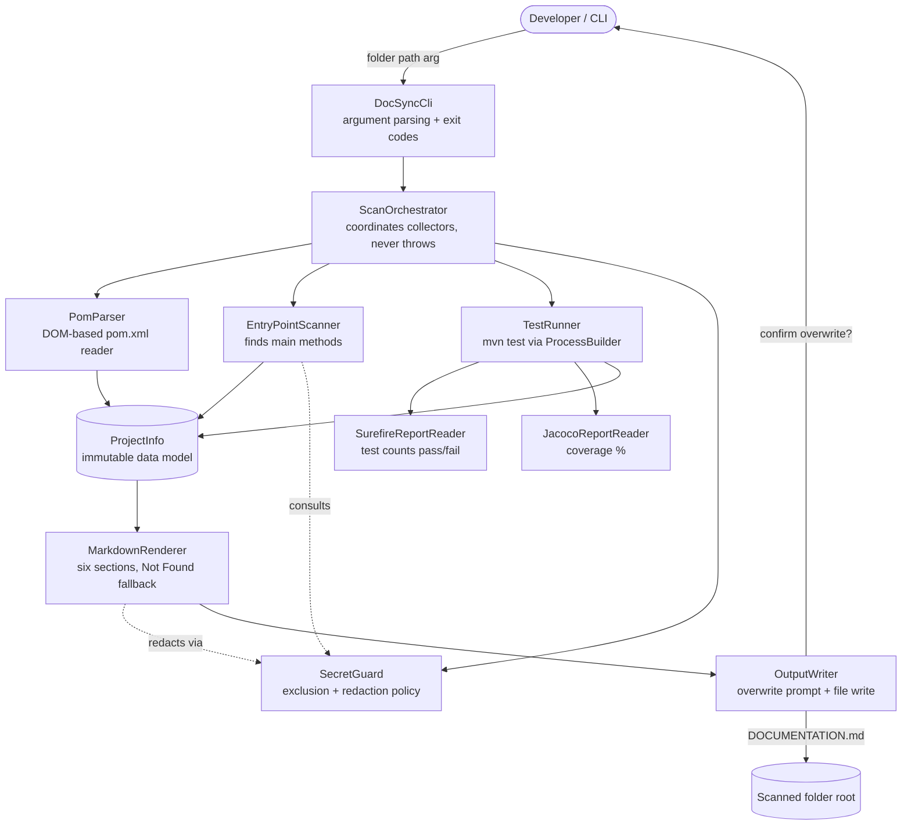
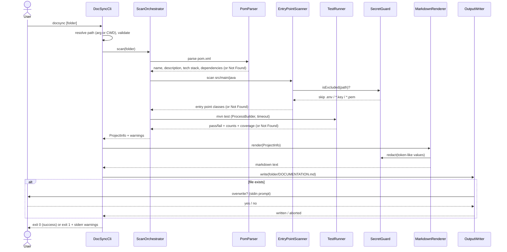

# Architecture — US-101: Automated Documentation Sync

> **Input artifact:** [requirements.md](./requirements.md) (Stage 1, Approved, commit `3a3e62d`)
> **Design decisions by user:** pom.xml parsing = built-in Java DOM parser; test execution = `ProcessBuilder` + report parsing.

## 1. Context and Goals

A one-shot Java 17 CLI tool (`docsync`) that scans a Maven project folder and generates a
`DOCUMENTATION.md` at its root. The architecture must satisfy these goals:

| Goal | Description | Requirement IDs |
|---|---|---|
| G-1 | Accept an optional folder argument, defaulting to the current working directory | FR-1 |
| G-2 | Produce `DOCUMENTATION.md` with exactly six sections (name, description, tech stack, dependencies, entry points, test status) | FR-2, FR-4, FR-5, FR-6, FR-7, FR-8 |
| G-3 | Never crash: degrade to `Not Found` entries, warn on stderr, use defined exit codes | FR-9, FR-10, FR-11, NFR-3 |
| G-4 | Never read or leak secrets (`.env`, `*.key`, `*.pem`, token-like values) | NFR-1, NFR-2 |
| G-5 | Ask before overwriting an existing `DOCUMENTATION.md` | FR-3 |
| G-6 | Stay maintainable and lightweight: Java 17 + Maven + JUnit 5 + JaCoCo, zero runtime third-party dependencies, no unnecessary file reads | NFR-4, NFR-5 |

## 2. Component Diagram

## 3. Components and Responsibilities

| Component | Responsibility | Requirement IDs |
|---|---|---|
| `DocSyncCli` | Entry point (`main`). Parses the optional folder argument, defaults to CWD, validates the path exists/is readable, maps outcomes to exit codes (0 = success, 1 = partial/error), prints warnings to stderr. | FR-1, FR-11, NFR-3 |
| `ScanOrchestrator` | Invokes each collector in sequence, catches every collector failure, substitutes `Not Found` values, accumulates warnings, and assembles the final `ProjectInfo`. Guarantees a result object is always produced. | FR-9, FR-10, FR-11, NFR-3 |
| `PomParser` | Reads `pom.xml` with the JDK built-in DOM parser (`javax.xml.parsers`, secure processing enabled). Extracts project name (`<name>` → `<artifactId>` fallback), description, Java version (`maven.compiler.source`/`java.version`), build tool, and dependencies (group/artifact, version, scope defaulting to `compile`). | FR-4, FR-5, FR-6 |
| `EntryPointScanner` | Walks `src/main/java` with `Files.walk`, reads only `.java` files, and detects classes containing `public static void main(String[] args)` via a line-level pattern match. Skips paths excluded by `SecretGuard`. | FR-7, NFR-5 |
| `TestRunner` | Runs `mvn test` in the target folder via `ProcessBuilder` with a timeout. Delegates result parsing to the report readers. Missing Maven or a failed launch yields `Not Found` + warning (OQ-3 resolution deferred to Design Review). | FR-8 |
| `SurefireReportReader` | Parses `target/surefire-reports/*.xml` (DOM) for total/passed/failed/skipped counts and derives pass/fail status. | FR-8 |
| `JacocoReportReader` | Parses `target/site/jacoco/jacoco.xml` (DOM) for line coverage %; absent report ⇒ coverage `Not Found`. | FR-8 |
| `SecretGuard` | Central security policy: (a) path exclusion — `.env`, `*.key`, `*.pem` are never opened or read; (b) output redaction — token-like strings (configurable regex set, e.g. AWS keys, bearer tokens, long high-entropy literals) are replaced with `[REDACTED]` before rendering. | NFR-1, NFR-2 |
| `ProjectInfo` (+ `Dependency`, `TestResult` records) | Immutable data model carrying all collected values; every field is `Optional`-like with an explicit `Not Found` representation. | FR-2, FR-9 |
| `MarkdownRenderer` | Renders `ProjectInfo` into the six required Markdown sections, emitting the literal `Not Found` for missing data, passing all output text through `SecretGuard` redaction. | FR-2, FR-9, NFR-2 |
| `OutputWriter` | Writes `DOCUMENTATION.md` at the scanned folder root. If the file exists, prompts on stdin for confirmation and aborts without writing when declined. | FR-2, FR-3 |

**Requirements coverage check:** FR-1…FR-11 and NFR-1…NFR-5 all trace to at least one component. No orphaned requirements.
(NFR-4 is satisfied by the technology choices in §5; NFR-5 by `EntryPointScanner` reading only `.java` files and the report readers reading only specific report files.)

## 4. Data Flow

## 5. Technology Choices

| Choice | Rationale | Alternatives rejected |
|---|---|---|
| **Java 17** (fixed) | Mandated by NFR-4; records, `Files.walk`, `Optional` suffice. | — |
| **Maven** build (fixed) | Mandated by NFR-4; also the only supported scanned-project type. | — |
| **JUnit 5 + JaCoCo** (fixed) | Mandated by NFR-4 for the tool's own tests and coverage. | — |
| **JDK built-in DOM parser** (`javax.xml.parsers`) for `pom.xml` and report files — *user-selected* | Zero runtime dependencies; extraction needs are shallow (top-level elements only); secure processing flag mitigates XXE. | **`maven-model` library**: typed API but adds a dependency and still no property interpolation without extra machinery. **Regex parsing**: fragile against XML comments/formatting. |
| **`ProcessBuilder` invoking `mvn test`** — *user-selected* | No dependency; uses whichever Maven is on PATH (A-3); Surefire/JaCoCo report parsing is required either way. | **`maven-invoker` library**: structured launch API but adds a dependency and still requires report parsing for counts/coverage. **Maven Embedder**: heavyweight, version-coupling risks. |
| **Plain `String`/`StringBuilder` Markdown rendering** | Output is a fixed six-section template; a template engine is over-engineering. | **Freemarker/Mustache**: unnecessary dependency for a static layout. |
| **Picocli-style arg parsing — rejected; hand-rolled single-arg parsing** | Only one optional positional argument (FR-1); a CLI framework adds no value. | **Picocli**: great for complex CLIs, overkill here. |

## 6. Error Handling and Security Approach

### Error handling (FR-9, FR-10, FR-11, NFR-3)
- **Never-crash rule:** `DocSyncCli.main` wraps everything in a top-level catch; no stack trace ever reaches the user — only one-line warnings on stderr.
- **Collector isolation:** `ScanOrchestrator` catches each collector's exceptions independently; one failing collector (e.g., unparseable `pom.xml`) degrades only its own fields to `Not Found` while others proceed (FR-10).
- **Partial output:** on invalid path / permission errors, whatever was collected is still rendered and written where possible; a warning goes to stderr and the exit code is non-zero (FR-11).
- **Exit codes:** `0` = full success; `1` = completed with warnings/partial data or user-declined overwrite handled per FR-3 (exact code for decline to be confirmed in Design Review); `2` = invalid invocation (unusable path).
- **Test-run safety:** `TestRunner` applies a process timeout and treats timeout/launch failure as `Not Found` + warning rather than an error.

### Security (NFR-1, NFR-2)
- **Single enforcement point:** all file-system traversal and all rendered output pass through `SecretGuard`, so the policy cannot be bypassed by an individual collector.
- **Exclusion before read:** `.env`, `*.key`, `*.pem` are filtered by *path* match before any `open()`/`read()` call — their contents are never loaded into memory (NFR-1, AC-6).
- **Output redaction:** a maintained regex set (AWS access keys, generic `api[_-]?key`/`token` assignments, JWT-shaped strings, high-entropy literals ≥ 32 chars) scrubs the final Markdown; matches are replaced with `[REDACTED]` (NFR-2). The exact pattern list implements OQ-2's interim answer and is a Design Review checkpoint.
- **XML hardening:** DOM parsing enables `FEATURE_SECURE_PROCESSING` and disables external entities/DTDs (XXE prevention) for `pom.xml` and report files.
- **No shell interpolation:** `ProcessBuilder` receives an argument list (no `sh -c`/`cmd /c` string), so folder names cannot inject commands.

### Open items carried to Design Review
- OQ-1: non-interactive `--force` flag for CI (affects `OutputWriter` only).
- OQ-2: finalize the token-detection regex set in `SecretGuard`.
- OQ-3: whether a missing Maven installation is `Not Found` (current design) or a hard error.
